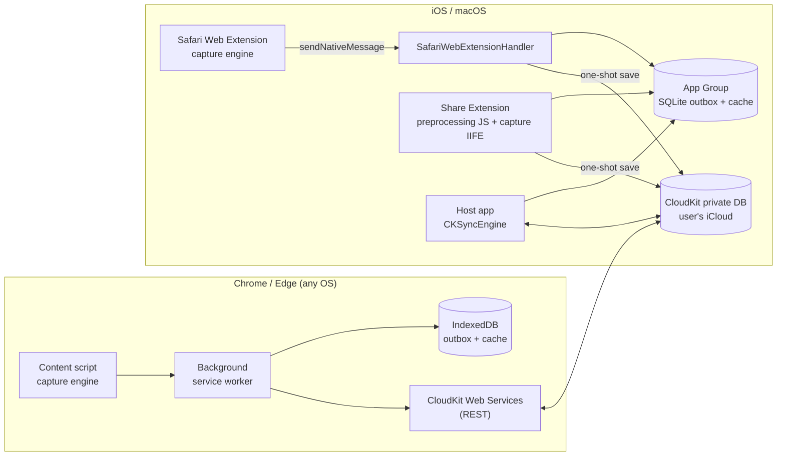

# Satchel — Product & Technical Specification

**Version** 0.2 · **Date** 2026-10-21 · **Status** Draft for implementation

> The product name is **Satchel** (bundle ID `com.cedarlogic.satchel`). Every identifier (bundle IDs, iCloud container, package scope, store names) still derives from a single config file (`config/app.config.json`), so it stays easy to change before store submission.

**Revision 0.2 changes**

- Product renamed from the working name "Stash" to **Satchel**, with final bundle, App Group, iCloud container, and code identifiers ([ADR-0010](adr/0010-name-and-identifiers.md)).
- Delivery order is now Phase 0 → Phase 1 (engine) → Phase 3 (Apple, iPhone only) → Phase 2 (Chrome/Edge); Spike A moves to the start of the Chrome/Edge phase ([ADR-0011](adr/0011-delivery-order-iphone-first.md)).
- Minimum OS raised to iOS 26 (macOS 26 when the Mac target is enabled) ([ADR-0012](adr/0012-ios-26-minimum.md)).
- Tooling: mise pins tools and runs thin tasks over `scripts/<aspect>/`; Biome replaces ESLint + Prettier; swift-format for Swift; `AGENTS.md` is the canonical agent file ([ADR-0013](adr/0013-tooling-mise-biome-swift-format.md)).
- Public, source-available repository with no secrets committed; gitleaks in pre-commit and CI ([ADR-0014](adr/0014-public-repo-source-available.md)).
- CalVer `YYYY.M.PATCH` single version shared by all targets ([ADR-0015](adr/0015-calver-versioning.md)).
- Scripted iOS release to TestFlight, GitHub Actions CI, and GitHub Pages hosting from `site/` ([ADR-0016](adr/0016-release-ci-and-hosting.md)).
- GRDB + SQLite (WAL) in the App Group confirmed as the Apple local store, with FTS5 search ([ADR-0017](adr/0017-local-store-grdb.md)).

---

## 0. Instructions for the implementing agent

You are implementing this spec in a new, single repository. Read the entire document before writing code.

1. **Start with Phase 0 (§14).** Several platform behaviors are marked **VERIFY**. Resolve each with a small spike and record the findings as an addendum to the relevant ADR before building on top of it.
2. **Split the ADRs.** Create `docs/adr/` and write each ADR in §13 to its own file (`0001-monorepo.md`, `0002-defuddle.md`, …). Save this spec as `docs/spec.md`.
3. **Create a root `AGENTS.md`** (canonical) summarizing repo layout, commands, and the conventions in §12.5, plus a root `CLAUDE.md` containing only `@AGENTS.md` (see ADR-0013). Keep `AGENTS.md` current as the repo evolves.
4. **Never deviate from an ADR silently.** If a decision proves wrong, write a superseding ADR explaining why.
5. **Work in small, reviewable commits** per milestone. Each phase has acceptance criteria; a phase is complete only when they pass.
6. **Hand human-only steps back to the human.** Apple Developer portal work (App IDs, App Group, iCloud container, CloudKit Console, API tokens), store accounts, and code signing cannot be done by you. Write exact step-by-step instructions for these in `docs/setup/` rather than guessing values.

---

## 1. Product overview

Satchel saves things from the web into storage the user owns. It has two capture modes:

- **Save link** — URL, title, a short description ("blurb"), and preview metadata. Fast and lightweight.
- **Save page** — the full article as clean Markdown with YAML frontmatter, in the spirit of the Obsidian and Notion web clippers. Images are referenced by URL at first. Later they are downloaded and stored alongside the page, with an export option that embeds them for a fully self-contained file.

The first user is the developer. The product will later ship on the App Store, Chrome Web Store, and Microsoft Edge Add-ons, so architecture decisions assume many users from day one.

### 1.1 Guiding principles

- **User-owned storage.** Data lives in the user's own cloud account and counts against their quota. The developer runs no servers and pays nothing per user.
- **Capture on the client.** Pages are captured from the DOM the user is looking at, including logged-in and JavaScript-rendered content. Nothing is re-fetched by a server.
- **One capture engine.** A single TypeScript module produces identical output on every platform.
- **Markdown is the product.** Output must be readable, portable, diff-friendly, and Obsidian-compatible.

### 1.2 Platforms

| Platform | Surfaces | Phase |
|---|---|---|
| iPhone / iPad | Host app (library, settings), Share Extension, Safari Web Extension | 3 — iPhone first; iPad/macOS later (see ADR-0011) |
| macOS | Host app (library, settings), Safari Web Extension | 3 — later (see ADR-0011) |
| Chrome (Windows, macOS, Linux, ChromeOS) | Manifest V3 extension | 2 |
| Microsoft Edge | Same MV3 extension, separate store build | 2 |

**Out of scope for v1:** Android app, Firefox (cheap to add later via WXT), a hosted web app, collaboration or sharing, highlights and annotations, server-side full-text search.

### 1.3 Storage providers

| Provider | Status |
|---|---|
| iCloud (CloudKit private database) | v1 default and only provider |
| Dropbox (App Folder) | Phase 6 |
| Google Drive (`drive.file` / `drive.appdata` scopes) | Phase 6 |
| OneDrive (app folder via Microsoft Graph) | Phase 6 |

Exactly one provider is active per user. The user selects it in settings and can migrate between providers (§8.5).

---

## 2. Glossary

- **Item** — one saved thing, either a link or a page.
- **Capture** — running the capture engine against a DOM to produce an Item.
- **Enrichment** — filling in metadata for a link saved without a DOM, such as a URL shared from a non-browser app.
- **Provider** — a storage backend implementing the storage contract (§8.1).
- **Outbox** — a durable local queue of pending writes, used when offline or after a failed write.
- **Local cache** — a per-device copy of the library used for listing and search.

---

## 3. Requirements

### 3.1 Functional requirements

Priority: **P0** = required for v1, **P1** = should have in v1, **P2** = later phase.

| ID | Requirement | Pri |
|---|---|---|
| FR-1 | Save the current page as a **link** from the Chrome/Edge toolbar popup, context menu, and keyboard shortcut. | P0 |
| FR-2 | Save the current page as a **full page** (Markdown) from the same entry points. | P0 |
| FR-3 | Save from Safari on iOS and macOS via the Safari Web Extension (toolbar or extensions menu; context menu on macOS only). | P0 |
| FR-4 | Save from the iOS share sheet. From Safari, both link and page modes are available. From other apps (URL only), link mode with deferred enrichment. | P0 |
| FR-5 | Optional tags and a short note at save time. One-tap save without them must also work. | P0 |
| FR-6 | Dedupe by normalized URL. Re-saving the same URL updates the existing Item: link → page upgrades it; page → page asks before replacing the saved copy. | P0 |
| FR-7 | Library view on every platform: list (newest first), client-side search over title, description, site, tags, and body; open the original URL; view rendered Markdown; copy Markdown; export `.md`; delete. | P0 |
| FR-8 | Offline tolerance: saves go to an outbox and sync when possible. The UI shows pending state. | P0 |
| FR-9 | Save a link target from the context menu (right-click a link) without visiting it; enrich later. | P1 |
| FR-10 | Save only the current text selection, as a page-type Item with `selection: true`. | P1 |
| FR-11 | Bulk export of the whole library as a zip of Markdown folders. | P1 |
| FR-12 | Download images for page Items and store them as assets; rewrite Markdown to reference the stored copies. | P2 (Phase 5) |
| FR-13 | Export a self-contained Markdown file with images embedded as Base64 data URIs, plus a folder export (`page.md` + `images/`). | P2 (Phase 5) |
| FR-14 | User-selectable storage provider and migration between providers. | P2 (Phase 6) |

### 3.2 Non-functional requirements

- A link save confirms in the UI within 1 second on a typical page, excluding network sync.
- A page capture completes within 3 seconds for a typical article on a mid-range laptop.
- The capture engine never throws on malformed pages. It degrades to link mode with a warning.
- No analytics or telemetry in v1. No third-party network calls other than the active storage provider, plus image loads when rendering saved pages (see §11).
- Extensions request minimal permissions (§9.1.2).

---

## 4. Capture engine

**Package:** `packages/capture`. Pure TypeScript: DOM in, data out.

The engine must not touch `window`, `location`, `chrome.*`, or `browser.*`. All inputs are passed explicitly, so it runs unchanged in an extension content script, in a `WKWebView` on iOS, in the iOS Share Extension's Safari preprocessing script, and in Node tests using linkedom.

### 4.1 Public API

```ts
export interface CaptureOptions {
  pageUrl: string;          // the document's URL (required; a cloned DOM may not know it)
  selectionHtml?: string;   // set when saving a selection only (FR-10)
  now?: Date;               // injectable clock for deterministic tests
}

export function captureLink(doc: Document, opts: CaptureOptions): LinkCapture;
export function capturePage(doc: Document, opts: CaptureOptions): Promise<PageCapture>;

export interface LinkCapture {
  metadata: PageMetadata;
  warnings: string[];
}

export interface PageCapture extends LinkCapture {
  markdown: string;         // full document including YAML frontmatter
  bodyMarkdown: string;     // Markdown without frontmatter
  images: ImageRef[];       // every image referenced in bodyMarkdown, in document order
  stats: { wordCount: number; readingMinutes: number };
  engine: { extractor: string; converter: string }; // e.g. "defuddle@0.19.2", "turndown@7.2.0"
}
```

`capturePage` must operate on a **clone** of the document so the live page is never mutated.

**Build outputs:**

- **ESM**, consumed by the extension through the workspace.
- **IIFE** bundle `dist/capture.iife.js` exposing `globalThis.SatchelCapture = { captureLink, capturePage, version }`. Consumed by the iOS Share Extension preprocessing script and by the host app's `WKWebView`-based enrichment.

### 4.2 Metadata resolution ("data islands")

Implement a lightweight `extractMetadata(doc, pageUrl)` that reads only `<head>` and JSON-LD scripts. This is the fast path for link mode. In page mode, merge its result with Defuddle's metadata: values from this resolver win, and Defuddle fills any gaps.

Resolve each field from the first non-empty source, in this order:

| Field | Sources, in priority order |
|---|---|
| `title` | `og:title` → `twitter:title` → JSON-LD `headline` / `name` → `<title>` → hostname + path |
| `description` | `og:description` → `twitter:description` → `<meta name="description">` → JSON-LD `description` → body excerpt (§4.3) |
| `siteName` | `og:site_name` → JSON-LD `publisher.name` → `<meta name="application-name">` → hostname without `www.` |
| `canonicalUrl` | `<link rel="canonical">` → `og:url` → `pageUrl`. Accept only absolute `http(s)` URLs. |
| `imageUrl` | `og:image:secure_url` → `og:image` → `twitter:image` → JSON-LD `image` (string, object `.url`, or first array entry) |
| `author` | JSON-LD `author.name` (multiple names joined with ", ") → `<meta name="author">` → `article:author` |
| `publishedAt` | `article:published_time` → JSON-LD `datePublished` → first `<time datetime>` inside `<article>` |
| `faviconUrl` | largest `apple-touch-icon` → `<link rel="icon">` (prefer largest `sizes`) → `/favicon.ico` |
| `lang` | `<html lang>` |
| `type` | `og:type` → JSON-LD `@type` |

**JSON-LD rules:**

- Parse every `script[type="application/ld+json"]`.
- Tolerate invalid JSON by skipping that script and adding a warning.
- Flatten top-level arrays and `@graph`.
- Prefer nodes whose `@type` is one of `Article`, `NewsArticle`, `BlogPosting`, `TechArticle`, `WebPage`, `VideoObject`, `Product`, or `Recipe`. Otherwise use the first node with a `name` or `headline`.

**Normalization:** resolve all URLs to absolute against `pageUrl`, respecting `<base href>`. Trim, collapse whitespace, and decode HTML entities in all strings. Truncate `description` to 300 characters at a sentence or word boundary, adding an ellipsis.

### 4.3 Body excerpt fallback

When no metadata description exists:

1. **Page mode:** use the first paragraph of Defuddle's content that has at least 80 characters of text.
2. **Link mode:** search `<article>`, then `<main>`, then `<body>` for the first `<p>` with at least 80 characters that is not inside `nav`, `header`, `footer`, or `aside`, and not inside an element whose class or id matches `/cookie|consent|subscribe|newsletter|promo|banner/i`.

### 4.4 Page capture pipeline

1. **Clone** the document.
2. **Pre-process images.** Promote lazy-load attributes (`data-src`, `data-lazy-src`, `data-original`, `data-srcset`) to `src`/`srcset`. For `srcset` and `<picture>`, choose the largest candidate. Recover images from `<noscript>` fallbacks. Make every `src` absolute.
3. **Extract** with Defuddle (ADR-0002) to get clean content HTML plus metadata.
4. **Post-process the HTML.** Make every `a[href]` absolute. Drop tracking pixels (declared 1×1, or `width`/`height` ≤ 2). Keep `data:` images under 8 KB and drop larger ones with a warning.
5. **Convert** to Markdown with Turndown (ADR-0003) using the conventions in §4.5.
6. **Collect** `ImageRef`s in document order.
7. **Assemble** the frontmatter (§5) and body.
8. **Apply guardrails.** If Defuddle returns fewer than 50 words, fall back to converting `<main>`, `<article>`, or `<body>` directly and add the warning `low-confidence-extraction`. If the final Markdown exceeds 10 MB, fail with a clear error and offer a link save instead.

### 4.5 Markdown conventions (Turndown configuration)

- ATX headings (`#`); fenced code blocks with the language taken from `language-*` or `lang-*` classes; `-` for bullets; `*` for emphasis; `**` for strong; inline links.
- GitHub-flavored tables, strikethrough, and task lists. **VERIFY** whether `turndown-plugin-gfm` is still maintained; if not, use the maintained fork `@joplin/turndown-plugin-gfm` or port the needed rules.
- Images as ``. Figures render as the image followed by the caption as an italic line.
- Preserve Defuddle's standardized footnotes and callouts in Obsidian-compatible syntax (`[^1]`, `> [!note]`).
- Math: keep `$…$` and `$$…$$` when Defuddle provides LaTeX.
- Remove empty links and links whose text is only whitespace. Collapse three or more blank lines to two. End the file with exactly one newline.
- Escaping must never mangle URLs or code.

---

## 5. Markdown file format

```markdown
---
id: u_3f9a1c0d7b2e4a58b6c1d2e3f4a5b6c7
type: page                # link | page
title: "How CloudKit Sync Works"
url: https://example.com/posts/cloudkit-sync?utm_source=x
canonical: https://example.com/posts/cloudkit-sync
site: Example Blog
author: Jane Doe
published: 2026-09-30
saved: 2026-10-21T14:03:22Z
updated: 2026-10-21T14:03:22Z
description: "A walkthrough of change tokens, zones, and conflict handling."
image: https://example.com/img/cover.jpg
tags: [cloudkit, swift]
source: chrome            # chrome | edge | safari-ios | safari-macos | ios-share
engine: defuddle@0.19.2 + turndown@7.2.0
---

# How CloudKit Sync Works

Body…
```

**Rules:**

- YAML must be valid. Quote strings that contain `:`, `#`, or leading special characters.
- Dates use ISO 8601.
- Unknown frontmatter fields are preserved on round-trip.
- Link-type Items also produce a Markdown file on export (frontmatter plus the description as body), so a library export is uniformly Markdown.

---

## 6. Architecture



**Key points:**

- The capture engine runs wherever the DOM is: extension content scripts (Chrome, Edge, Safari), the Share Extension's Safari preprocessing script, and a hidden `WKWebView` in the host app for enrichment.
- **Safari never calls CloudKit Web Services.** It hands captures to native code, which uses the CloudKit framework with the device's iCloud account (ADR-0007). No Apple ID web sign-in is ever needed on Apple devices.
- **Chrome and Edge use CloudKit Web Services** with an API token plus a per-user web auth token obtained from Apple ID sign-in (§8.3).
- Every client keeps a local cache for fast listing and search, and an outbox for durable writes.

---

## 7. Data model

**Package:** `packages/model` (TypeScript) mirrored by `SatchelKit` (Swift).

### 7.1 Item

```ts
type ItemId = string; // "u_" + first 32 hex chars of SHA-256(normalizedUrl)
type ClientId = 'chrome' | 'edge' | 'safari-ios' | 'safari-macos' | 'ios-share' | 'ios-app' | 'macos-app';

interface Item {
  schemaVersion: 1;
  id: ItemId;
  kind: 'link' | 'page';
  url: string;               // as captured
  canonicalUrl: string;
  normalizedUrl: string;     // §7.2; input to id
  title: string;
  description?: string;
  siteName?: string;
  author?: string;
  publishedAt?: string;      // ISO 8601
  imageUrl?: string;
  faviconUrl?: string;
  lang?: string;
  tags: string[];            // lowercase, trimmed, deduplicated
  note?: string;
  selection?: boolean;       // FR-10
  createdAt: string;         // first save; never changes
  updatedAt: string;
  capturedAt?: string;       // last page capture
  metadataStatus: 'complete' | 'pending' | 'failed'; // pending = awaiting enrichment
  source: { client: ClientId; version: string };
  page?: {
    wordCount: number;
    readingMinutes: number;
    engine: string;
    images: ImageRef[];
  };
}

interface ImageRef {
  originalUrl: string;
  alt?: string;
  status: 'remote' | 'stored' | 'failed'; // only 'remote' until Phase 5
  assetKey?: string;         // provider-specific reference once stored
  contentType?: string;
  bytes?: number;
}
```

The Markdown body is stored separately from the metadata record (§8).

**Deterministic IDs.** Deriving the ID from the normalized URL makes dedupe free and makes concurrent saves of the same URL on two devices converge on a single record. The trade-off is that two independent saves of the same URL cannot coexist, which is intended. The normalization algorithm is versioned; changing it requires a migration.

**Contract fixtures.** `fixtures/model/` holds JSON Item fixtures. Both the TypeScript and Swift test suites must decode and re-encode every fixture losslessly.

### 7.2 URL normalization (v1)

1. Parse the URL and reject anything other than `http` or `https`.
2. Lowercase the scheme and host, strip a leading `www.`, and remove default ports.
3. Remove the fragment, except `#!` hashbang routes.
4. Remove tracking parameters: `utm_*`, `fbclid`, `gclid`, `dclid`, `msclkid`, `mc_cid`, `mc_eid`, `igshid`, `ref_src`, `_hsenc`, `_hsmi`, `yclid`.
5. Sort the remaining query parameters by key (stable for repeated keys).
6. Remove a trailing `/` from the path unless the path is `/`.
7. Use the canonical URL as input when it is on the same registrable domain as the page URL; otherwise use the page URL.

### 7.3 Merge rules

These apply when an existing ID is saved again and when resolving sync conflicts.

- `createdAt`: earliest wins.
- `kind`: `page` beats `link`.
- `tags`: union.
- `note`: most recently updated wins.
- Metadata fields: values from the newer capture win, but a non-empty value is never overwritten with an empty one.
- Body: the newer page capture wins. When the user re-saves a page that already has a body, the client asks "Replace saved copy?" first.

---

## 8. Storage

**Package:** `packages/storage` (TypeScript) and the `ItemStore` protocol in `SatchelKit` (Swift).

### 8.1 Storage contract

```ts
interface StorageProvider {
  readonly id: 'cloudkit' | 'dropbox' | 'gdrive' | 'onedrive';

  connect(): Promise<AccountInfo>;          // interactive sign-in if needed
  disconnect(): Promise<void>;
  status(): Promise<ConnectionStatus>;

  getItem(id: ItemId): Promise<StoredItem | null>;
  getBody(id: ItemId): Promise<string | null>;
  putItem(item: Item, body?: string, opts?: { ifVersion?: string }): Promise<StoredItem>;
  deleteItem(id: ItemId): Promise<void>;

  /** Incremental sync. Pass the previous cursor, or null for a full listing. */
  listChanges(cursor: string | null): Promise<{
    upserts: StoredItem[];
    deletes: ItemId[];
    cursor: string;
    more: boolean;
  }>;

  // Phase 5
  putAsset?(itemId: ItemId, data: Blob, contentType: string): Promise<{ assetKey: string }>;
  getAsset?(itemId: ItemId, assetKey: string): Promise<Blob>;
}

interface StoredItem {
  item: Item;
  version: string;  // CloudKit recordChangeTag, file revision, ETag, etc.
}
```

`putItem` with `ifVersion` performs optimistic concurrency. On conflict, the provider throws `ConflictError` carrying the server copy; the caller applies the merge rules (§7.3) and retries.

The Swift `ItemStore` protocol mirrors this contract. In v1, only `CloudKitItemStore` exists on Apple platforms.

### 8.2 CloudKit schema

- **Container:** `iCloud.com.cedarlogic.satchel`. **Database:** private. **Custom zone:** `Library` (required for zone change tracking).
- **Record type `Item`.** Record name = `Item.id`.

| Field | CloudKit type | Index | Notes |
|---|---|---|---|
| `schemaVersion` | Int64 | | |
| `kind` | String | queryable | |
| `url`, `canonicalUrl` | String | | |
| `normalizedUrl` | String | queryable | |
| `title`, `description`, `siteName`, `author`, `lang` | String | | |
| `createdAt` | Date/Time | sortable | |
| `publishedAt`, `updatedAt`, `capturedAt` | Date/Time | | |
| `imageUrl`, `faviconUrl`, `note`, `metadataStatus` | String | | |
| `tags` | String List | queryable | |
| `source` | String (JSON) | | |
| `page` | String (JSON) | | wordCount, readingMinutes, engine, images |
| `body` | String | | Markdown, when its UTF-8 size ≤ 512 KB |
| `bodyAsset` | Asset | | Markdown, when larger (CloudKit records are limited to 1 MB) |

Readers check `body` first, then `bodyAsset`. Writers set exactly one and clear the other.

- **Record type `ImageAsset` (Phase 5).** Record name = `<itemId>_<first 16 hex of SHA-256(originalUrl)>`. Fields: `item` (Reference to `Item`, delete-self action), `originalUrl`, `contentType`, `bytes`, `file` (Asset).
- Make `recordName` queryable (needed for Dashboard and Web Services queries).
- The schema is created in the **Development** environment and deployed to **Production** before any release build (Phase 7).

### 8.3 CloudKit access per platform

| Platform | Mechanism | Auth |
|---|---|---|
| iOS / macOS host app | CloudKit framework with **CKSyncEngine** | Device iCloud account; no sign-in UI |
| Share Extension, Safari extension handler | CloudKit framework, one-shot `modifyRecords` saves | Device iCloud account |
| Chrome / Edge | CloudKit Web Services REST at `https://api.apple-cloudkit.com/database/1/{container}/{environment}/private/…` using `records/modify`, `records/lookup`, `changes/zone`, `zones/modify`, `assets/upload`, `users/current` | `ckAPIToken` + `ckWebAuthToken` |

**Chrome/Edge sign-in flow — VERIFY in Spike A (at the start of the Chrome/Edge phase; see ADR-0011).**

The documented flow: a request to `users/current` without a web auth token returns a `redirectURL` to Apple's sign-in page. If the API token was created in CloudKit Console with a custom sign-in callback URL, Apple appends `ckWebAuthToken` to that callback after the user signs in. The plan is to open the sign-in page with `chrome.identity.launchWebAuthFlow` and use the extension's `https://<extension-id>.chromiumapp.org/` URL as the callback.

Questions the spike must answer:

- Does CloudKit Console accept a `chromiumapp.org` callback URL? If not, host a tiny static callback page (for example on GitHub Pages) that forwards the token to the `chromiumapp.org` URL.
- Chrome Web Store and Edge Add-ons assign **different extension IDs**, so each needs its own callback. Decide between separate API tokens and one relay page that forwards to either.
- How long does the web auth token live, and do responses return a refreshed token that must replace the stored one?
- On expiry, the background worker must detect `AUTHENTICATION_REQUIRED`, prompt for sign-in, and keep all outbox items intact.

Store the web auth token in `chrome.storage.local` (never in synced storage). The API token is not a secret — it ships in the client — but it is scoped to one container and environment.

### 8.4 File-based providers (Phase 6)

Dropbox, Google Drive, and OneDrive store plain files in an app-scoped folder:

```
<AppFolder>/
  items/
    u_3f9a…/
      item.json          # Item record
      page.md            # page Items only; full Markdown with frontmatter
      images/            # Phase 5
        <hash>.jpg
  tombstones/
    u_3f9a….json         # { id, deletedAt } so deletes propagate
  library-index.json     # cache only; always rebuildable from items/
```

- One folder per Item keeps concurrent edits to different Items conflict-free.
- Sync uses each provider's change cursor: Dropbox `list_folder/continue`, Google Drive `changes.list` with a page token, Microsoft Graph `delta`.
- Writes use the provider's revision or ETag for optimistic concurrency.
- Users can point Obsidian at the Dropbox folder. Mention this in the store listing.
- Google: request only the `drive.file` or `drive.appdata` scopes. Broader Drive scopes trigger Google's costly restricted-scope verification.
- Safari has no `identity` API. On Apple platforms, OAuth for these providers runs in the host app (`ASWebAuthenticationSession`), tokens live in a shared Keychain access group, and the Safari extension handler performs provider writes natively.

### 8.5 Provider selection and migration

- Settings shows the active provider and account. v1 shows iCloud only; other providers appear in Phase 6.
- Switching providers runs a migration: read everything from the old provider (`listChanges(null)`, bodies, assets), write it to the new one, verify counts and checksums, then mark the new provider active. Old data is left untouched, and the user is told where it remains.
- Each device stores its active-provider choice locally. The first device to switch writes a `provider.json` marker to the old provider so other devices detect the change and prompt the user.

---

## 9. Clients

### 9.1 Browser extension (Chrome, Edge, Safari) — `apps/extension`

Built with WXT (ADR-0005). One codebase, three build targets: `chrome` (MV3), `edge` (MV3), and `safari` (MV3). **Set MV3 explicitly for Safari**; WXT defaults Safari builds to MV2.

#### 9.1.1 Entry points

- **Popup.** Shows the current tab's title, URL, and favicon. Buttons: **Save link** (default, bound to Enter) and **Save page**, plus **Save selection** when text is selected. Tag input with autocomplete from known tags, a note field, and a status line (saved, queued, or error with retry). Link to the Library.
- **Context menus** (Chrome, Edge, and Safari on macOS — not available on iOS): "Save page link", "Save full page", "Save link target" (on `<a>` elements), "Save selection".
- **Keyboard commands:** `Alt+Shift+L` saves a link, `Alt+Shift+P` saves a page. Users can remap both.
- **Library page** (`library.html`, opened in a tab; Chrome, Edge, and Safari on macOS): list, search, detail view with rendered Markdown, copy, export, delete, and sync status. On Safari for iOS, the popup instead links to the host app (`satchel://library`).
- **Options page:** provider and account (sign in/out), default save mode, the remote-image loading toggle (§11), and library export.

#### 9.1.2 Permissions

| Permission | Purpose | Targets |
|---|---|---|
| `activeTab`, `scripting` | Inject the capture script into the current tab on user action | all |
| `storage` | Settings, tokens, small state | all |
| `contextMenus` | Right-click entry points | chrome, edge, safari (ignored on iOS) |
| `alarms` | Outbox retry and periodic sync | all |
| `identity` | Apple ID sign-in via `launchWebAuthFlow` | chrome, edge |
| `offscreen` | `DOMParser` for link-target enrichment | chrome, edge |
| `nativeMessaging` | Hand captures to the native handler | safari |
| host `https://api.apple-cloudkit.com/*` | CloudKit Web Services | chrome, edge |
| optional host `<all_urls>` | Fetch HTML for link-target enrichment; requested on first use | chrome, edge |

No broad host permissions are granted by default; capture relies on `activeTab`.

#### 9.1.3 Platform adapters

All browser-specific code lives in `apps/extension/src/platform/`:

```ts
interface PlatformAdapter {
  save(capture: LinkCapture | PageCapture, extras: SaveExtras): Promise<SaveResult>;
  library(): LibraryAccess | null;   // null on Safari iOS (the host app is the library)
  hasContextMenus(): boolean;
  enrich?(url: string): Promise<LinkCapture>;
}
```

- **`chromium.ts`:** writes to the IndexedDB outbox, then saves through `CloudKitWebProvider` from `packages/storage`.
- **`safari.ts`:** sends the capture through `browser.runtime.sendNativeMessage` to the native handler. **VERIFY** (Spike D) the maximum native message size on iOS and macOS. If large pages exceed it, send the body in chunks using `begin` / `chunk` / `commit` messages keyed by Item ID.

Use `import.meta.env.SAFARI` for build-time branching and feature detection (`'contextMenus' in browser`) at runtime.

#### 9.1.4 Local cache, search, rendering

- IndexedDB (via `idb`) stores Items, bodies (lazy-loaded), the outbox, and the sync cursor.
- Search uses a MiniSearch index over title, description, site name, tags, and body, updated incrementally.
- Rendering uses `markdown-it` with output sanitized by DOMPurify. This renderer is its own package, `packages/render`, also built as an IIFE and reused by the Apple host app inside a `WKWebView`, so saved pages render identically everywhere.

### 9.2 Apple apps — `apple/`

Minimum OS: iOS 26 (macOS 26 when the Mac target is enabled) (see ADR-0012). Swift 6 language mode. SwiftUI.

#### 9.2.1 Targets

| Target | Platforms | Role |
|---|---|---|
| `Satchel` (host app) | iOS, macOS | Library, detail view, settings, onboarding for enabling the Safari extension, sync owner (CKSyncEngine), enrichment |
| `SatchelShare` | iOS | Share Extension |
| `SatchelSafari` | iOS, macOS | Safari Web Extension: web resources from the WXT Safari build plus `SafariWebExtensionHandler` |
| `SatchelKit` (Swift package) | iOS, macOS | Model, local store, CloudKit store, outbox, merge rules, settings |

The App Group `group.com.cedarlogic.satchel` shares the SQLite database and settings across all targets. Use GRDB with WAL mode, which is safe for concurrent access from the app and its extensions. All three targets carry the iCloud (CloudKit) entitlement for the same container.

#### 9.2.2 Share Extension

- **Activation:** URLs and web pages. When invoked from Safari, an `NSExtensionJavaScriptPreprocessingFile` runs inside the page, loads the capture IIFE, and returns both `captureLink` and `capturePage` results.
- **UI:** a compact sheet with **Save link** (primary), **Save page** (only when a page capture is available), tags, and note.
- **From non-Safari apps** (URL only): save as a link with `metadataStatus: 'pending'`. The host app enriches it later.
- **Write path:** insert into the App Group outbox, then attempt a direct CloudKit save within the extension's time budget. On success, mark the outbox row `sent`. On failure, leave it for the host app.
- **Memory:** share extensions run under tight memory limits. Never load images; pass Markdown as a string.

#### 9.2.3 Safari Web Extension handler

- `SafariWebExtensionHandler.beginRequest(with:)` handles the messages `save`, `begin`/`chunk`/`commit` (if chunking is needed), `status`, and `tags` (for autocomplete).
- Uses the same write path as the Share Extension: outbox first, then a one-shot CloudKit save.
- Never runs CKSyncEngine. Only the host app does, to avoid competing sync state.

#### 9.2.4 Host app

- **Sync:** CKSyncEngine against the `Library` zone, mapping records to and from the `SatchelKit` model. Drains the outbox on launch, on foreground, and from a `BGAppRefreshTask`. Registers for CloudKit push notifications to receive remote changes promptly.
- **Enrichment:** for `pending` Items, load the URL in a hidden `WKWebView`, inject the capture IIFE, call `captureLink`, and merge the result. Rate-limit requests and skip enrichment on cellular when Low Data Mode is on.
- **Library UI:** list with search (SQLite FTS5), filters by tag and kind, a detail view rendering Markdown through the shared renderer in a `WKWebView`, share and export, delete, and open in Safari.
- **Onboarding:** explain how to enable the Safari extension on iOS and macOS, show iCloud account status, and explain what happens when iCloud is unavailable (saves queue locally until it returns).
- **macOS app:** the same SwiftUI views in a sidebar layout. It exists primarily because a Safari extension must ship inside an app.

---

## 10. Images (Phase 5)

1. After a page is saved, the client that captured it downloads the images, because it has the right cookies and referrer. In browsers this happens from the tab's context; on iOS, from the host app.
2. Skip images larger than 10 MB each or 50 MB per page in total, marking them `failed` with a reason.
3. Store each image via `putAsset`: a CloudKit `ImageAsset` record, or `images/<hash>.<ext>` for file providers.
4. Rewrite the stored Markdown to reference images by the provider-neutral relative path `images/<hash>.<ext>` and set `ImageRef.status = 'stored'`. Renderers resolve these paths through the active provider.
5. Export offers **Folder** (`page.md` + `images/`) and **Self-contained** (Markdown with `data:<type>;base64,…` URIs). Base64 is never the storage format (ADR-0009).

---

## 11. Security and privacy

- No developer-operated servers and no analytics. Data flows only between the user's devices and their chosen provider.
- **Tokens:** Keychain (shared access group) on Apple platforms; `chrome.storage.local` in Chrome and Edge. Safari does not need CloudKit tokens.
- **Rendering:** saved content is never rendered as raw HTML. Markdown is rendered and sanitized with DOMPurify: no scripts, iframes, or event handlers.
- **Remote images:** rendering a saved page with remote images contacts third-party servers. Provide a **Load remote images** setting, on by default for development builds; decide the store default in Phase 7 (open question).
- Content scripts are injected only on user action (`activeTab`), never into every page.
- A privacy policy is required for all three stores (Phase 7).

---

## 12. Repository

### 12.1 Layout

```
satchel/
  AGENTS.md                     # canonical agent instructions (ADR-0013)
  CLAUDE.md                     # contains only `@AGENTS.md`
  README.md
  LICENSE                       # source-available, all rights reserved (ADR-0014)
  THIRD_PARTY_NOTICES.md        # attributions for MIT and other third-party deps
  mise.toml                     # pinned tools + thin tasks calling scripts/ (ADR-0013)
  package.json                  # pnpm workspace root and scripts
  pnpm-workspace.yaml
  turbo.json
  tsconfig.base.json
  .github/workflows/
    ci-web.yml                  # Ubuntu: lint, typecheck, tests, Chrome/Edge zips
    ci-apple.yml                # macOS: generate project, build targets, SatchelKit tests
  scripts/                      # all task logic; mise tasks are one-line wrappers (ADR-0013)
    setup/
    build/
    verify/
    deploy/
    art/
    ci/
    hooks/
  art/                          # source artwork (icons, etc.)
  site/                         # GitHub Pages: privacy policy, support (ADR-0016)
  store/                        # App Store / Chrome / Edge store artwork
  config/
    app.config.json             # name, slug, bundle prefix, container ID — single source of truth
  docs/
    spec.md                     # this document
    adr/                        # one file per ADR
    setup/                      # human-only steps: Apple Developer, CloudKit, stores, signing
  fixtures/
    pages/                      # HTML snapshots + expected Markdown (golden tests)
    model/                      # Item JSON contract fixtures (TS + Swift)
  packages/
    model/                      # types, JSON Schema, URL normalization, merge rules
    capture/                    # capture engine (ESM + IIFE)
    render/                     # markdown-it + DOMPurify renderer (ESM + IIFE)
    storage/                    # StorageProvider contract + cloudkit-web adapter (later: dropbox, gdrive, onedrive)
  apps/
    extension/                  # WXT project → chrome, edge, safari builds
  apple/
    project.yml                 # XcodeGen definition (ADR-0008); .xcodeproj is generated, not committed
    Satchel/                    # host app sources (iOS now; macOS later)
    SatchelShare/               # Share Extension
    SatchelSafari/              # SafariWebExtensionHandler (Info.plist/entitlements generated from project.yml)
    SatchelKit/                 # Swift package
    Staged/                     # gitignored; web build outputs staged for Xcode
  scripts/build/
    web-for-apple.sh            # builds capture/render IIFEs and the WXT Safari target; stages outputs for Xcode
```

### 12.2 Tooling

- Node LTS, pnpm workspaces, Turborepo for task orchestration and caching.
- mise pins the toolchain and defines thin tasks that call scripts under `scripts/<aspect>/` (see ADR-0013).
- TypeScript in `strict` mode, ESM everywhere, Vitest, Biome for linting and formatting (replaces ESLint + Prettier; see ADR-0013).
- swift-format (`swift format`, bundled with the Xcode toolchain) for Swift (see ADR-0013).
- WXT for the extension. Vite library mode (or tsup) for the IIFE bundles.
- XcodeGen generates `Satchel.xcodeproj`. Swift Package Manager for `SatchelKit` and third-party Swift packages (GRDB).
- Pin exact versions of `defuddle` and `turndown` (no `^` or `~`). Upgrades go through the golden tests.

### 12.3 Build integration between web and Apple code

- `scripts/build/web-for-apple.sh` builds `packages/capture`, `packages/render`, and the extension's Safari target (MV3), then stages the outputs in `apple/Staged/` where the Xcode targets expect them.
- The Xcode project runs this script once, from a `WebAssets` aggregate target that `Satchel`, `SatchelShare`, and `SatchelSafari` all depend on (via `scripts/build/xcode-web-phase.sh`, which locates mise because Xcode runs scripts with a minimal `PATH`).
- The `SatchelSafari` target copies the staged WXT Safari output to the root of the `.appex` in a build phase (matching the packager's layout; see the ADR-0005 addendum), so the Safari extension always matches the latest web build and can never drift from Chrome/Edge.

### 12.4 Testing

- **Golden tests for capture.** Each fixture is a folder `fixtures/pages/<name>/` containing `input.html`, `url.txt`, `expected.md`, and `expected-metadata.json`. Tests run in Node with linkedom. Start with at least 20 pages covering: news sites, personal blogs, documentation sites, GitHub READMEs, Substack, Medium, recipes, pages with no Open Graph tags, pages with only JSON-LD, lazy-loaded images, code-heavy articles, math, and footnotes. `pnpm test:golden -u` updates expectations deliberately.
- **Contract tests.** Model fixtures round-trip losslessly in both TypeScript and Swift.
- **Storage tests.** A shared provider contract test suite runs against an in-memory fake on every CI run, and manually (behind a flag) against the CloudKit Development environment.
- **Extension tests.** Vitest for logic. A Playwright smoke test loads the unpacked Chrome build and saves a local fixture page.
- **Apple tests.** Swift Testing for `SatchelKit` (merge rules, outbox, record mapping). A manual test plan for the extensions in `docs/setup/manual-test-plan.md`.

### 12.5 Conventions (copy into CLAUDE.md)

- Never call `chrome.*` or `browser.*` outside `apps/extension/src/platform/` and the extension entry points.
- Never access `window` or `location` inside `packages/capture`.
- Every new or changed capture rule ships with a fixture.
- No new runtime dependency without a one-line justification in the commit message.
- All product identifiers come from `config/app.config.json`.
- Do not hand-edit generated files (`.xcodeproj`, WXT output, IIFE bundles).

---

## 13. Architecture Decision Records

Each ADR below now lives in its own file under [`docs/adr/`](adr/README.md); those files are canonical, and ADR-0010 onward exist only there.

### ADR-0001: Single repository (monorepo)

**Status:** Accepted

**Context.** The product spans TypeScript (capture engine, renderer, storage adapters, browser extension) and Swift (host apps, Share Extension, Safari extension handler). The capture engine and renderer must be identical across Chrome, Edge, Safari, and the iOS Share Extension. The data model exists in both languages.

**Decision.** Use one repository: pnpm workspaces and Turborepo for TypeScript, and an `apple/` directory holding an XcodeGen-defined project and a local Swift package. Web artifacts flow into Apple targets through a build script, never through copies committed to the repo.

**Consequences.**
- ✅ Atomic changes across model, capture engine, and every client.
- ✅ One CI pipeline and one fixture corpus shared by all platforms.
- ✅ The Safari extension cannot drift from the Chrome/Edge extension.
- ⚠️ Apple builds require the Node toolchain on the Mac.
- ⚠️ CI needs both Ubuntu and macOS runners.

**Alternatives considered.**
- *Separate repositories per platform:* code drift and version juggling between repos.
- *Publishing the capture engine as an npm package consumed by separate repos:* release overhead with no benefit for a solo developer.
- *Nx instead of Turborepo:* more capability than needed.

### ADR-0002: Defuddle for content extraction

**Status:** Accepted

**Context.** Page saves must turn an arbitrary page's DOM into the main article content, preserving structure (headings, code, tables, footnotes, math, figures). The extractor must run in browser content scripts, in `WKWebView` on iOS, and in Node for tests.

**Decision.** Use Defuddle (MIT license, TypeScript, by Stephan Ango), pinned to an exact version and wrapped behind our own `extractContent()` interface.

**Reasons.**
1. **Purpose-built for web clipping.** Defuddle is the extraction engine of the Obsidian Web Clipper — the closest existing product to ours — so it is exercised daily on an enormous variety of real-world pages.
2. **Standardized output, not just extraction.** It normalizes footnotes, code blocks, math, headings, and callouts into consistent HTML, so the Markdown conversion step is predictable. Readability returns cleaned HTML but does little normalization.
3. **Less aggressive than Readability.** It is designed to keep borderline content rather than discard it. For an archiving tool, losing content is worse than keeping a little clutter.
4. **Metadata included.** It returns title, author, published date, site, description, image, favicon, and schema.org data, overlapping and backstopping our own resolver (§4.2).
5. **Runs everywhere we need.** A zero-dependency browser bundle for content scripts and `WKWebView`, and `defuddle/node`, which accepts a `Document` from any DOM implementation (linkedom, JSDOM, happy-dom) for fast Node golden tests.

**Risks and mitigations.**
- *Pre-1.0 (0.x versions):* API and output can change between releases. → Exact version pin, golden tests, deliberate upgrades.
- *Small maintainer base:* → The `extractContent()` wrapper allows swapping in Mozilla Readability. Optionally keep a Readability adapter behind a development flag for side-by-side comparison.
- *Known extraction bugs* (for example, inline links inside figure captions are currently flattened). → Track upstream issues and contribute fixes; add local post-processing only when unavoidable.

**Alternatives considered.**
- *Mozilla Readability (Apache-2.0):* mature, powers Firefox Reader View; more aggressive content removal, minimal normalization, limited metadata. Kept as the fallback.
- *Postlight/Mercury Parser:* effectively unmaintained.
- *Hosted "reader" extraction APIs:* violate the client-side capture and privacy principles, cost money per request, and cannot see logged-in content.
- *Writing our own extractor:* years of edge cases already solved elsewhere.

### ADR-0003: Turndown for HTML → Markdown

**Status:** Accepted

**Context.** Defuddle produces clean HTML. We need Markdown with precise control over images (Phase 5 rewrites them to stored asset paths), figures, code fences, tables, and Obsidian-compatible syntax.

**Decision.** Use Turndown (MIT license), pinned to an exact version, with GFM rules and our own custom rules in `packages/capture/src/markdown/`.

**Reasons.**
1. **The de facto standard** HTML-to-Markdown converter in JavaScript, with years of production use. Defuddle's own Markdown output is built on Turndown, so Defuddle's standardized HTML is designed to convert cleanly with it.
2. **Rule-based extensibility.** `addRule`, `keep`, and `remove` cover image rewriting, figure captions, callouts, and code-language detection without forking anything.
3. **Portable.** Runs in browsers and Node against any DOM, with a small bundle and no native dependencies.
4. **Decouples conversion from extraction.** Owning the converter configuration means a Defuddle upgrade cannot silently change our Markdown conventions, and vice versa. Each is pinned and golden-tested independently.

**Implementation note — VERIFY in Phase 0, Spike C.** Check whether Defuddle's full bundle exposes its Markdown conversion or Turndown rules for reuse. If its Turndown instance can be extended with our rules, use it as the base to inherit Defuddle's callout, footnote, and math handling. Otherwise instantiate Turndown directly and port the needed rules (both projects are MIT; keep attribution).

**Risks.** Turndown releases are infrequent, and the original GFM plugin appears stale. → Use the maintained fork or port the rules; golden tests catch regressions.

**Alternatives considered.**
- *unified / rehype-remark:* AST-based and powerful, but a heavier bundle and a larger configuration surface. Overkill unless we later need Markdown AST transforms (for example, highlights); revisit then.
- *node-html-markdown:* fast, but Node-oriented and less flexible for custom rules.
- *Defuddle's `markdown: true` option alone:* simplest, but less control over images and output conventions. Acceptable as an emergency fallback.

### ADR-0004: CloudKit first, behind a provider abstraction

**Status:** Accepted

**Context.** The app is personal today and heading to the stores. The developer must not pay for users' storage. Target devices are Apple devices plus Chrome and Edge on Windows and other platforms.

**Decision.** Use the CloudKit private database as the v1 and only provider. Define the provider-neutral storage contract (§8.1) now, and add file-based providers (Dropbox, Google Drive, OneDrive) in Phase 6.

**Reasons.**
- Private-database storage counts against the user's own iCloud quota, not the developer's.
- Zero sign-in on Apple devices, where most saving will happen.
- Mature sync primitives: custom zones, change tokens, CKSyncEngine, push notifications.
- A clear privacy story: the developer never has access to user data.

**Consequences.**
- Chrome and Edge users must have an Apple ID and sign in through Apple's web flow; the extension sign-in needs a spike (§8.3).
- Requires the paid Apple Developer Program.
- The CloudKit schema must be deployed to Production before release.
- CloudKit Web Services is older and less documented than the native API, so the TypeScript adapter stays small and heavily tested.
- Data-model choices (separate body, deterministic IDs, tombstones, provider-neutral image paths) were made so they map cleanly onto file-based providers later.

**Alternatives considered.**
- *Dropbox first:* simplest cross-platform API, but requires OAuth on every device including Apple ones.
- *Supabase or Firebase:* the developer pays for all users' data.
- *Local-only with Syncthing:* no workable iOS story.

### ADR-0005: Safari via the shared WXT codebase and Apple's packager

**Status:** Accepted, pending Spike B addendum

**Context.** We want Safari on iOS and macOS from the same code as Chrome and Edge. Apple provides `safari-web-extension-packager` (formerly named `safari-web-extension-converter`), available as `xcrun safari-web-extension-packager` with Xcode and as a web-based tool in App Store Connect.

**What the tool actually does.** Despite the old "converter" name, it does not convert code. It generates an Xcode project containing a host app target (iOS and/or macOS) and a Safari Web Extension target that wraps the existing extension files, plus a stub `SafariWebExtensionHandler` that simply echoes native messages. It reports manifest keys and APIs that Safari does not support. By default the project *references* the original extension files, so rebuilding the web extension updates the Safari extension; `--copy-resources` copies them instead. `--rebuild-project` regenerates an existing project with different options or platforms.

**Assessment: is it clean?**

What is clean:
- The web code is untouched. All extension JavaScript, HTML, and CSS is shared, and Safari reads the same MV3 manifest, ignoring keys it does not support.
- The scaffold is deterministic, and its compatibility warnings are genuinely useful.

What is not clean:
1. **It is a one-shot scaffold, not a build step.** The output is a template project with a placeholder host app, generic UI, and default bundle IDs and team settings. Every customization lives in `project.pbxproj`, which is hard to diff and merge, and re-running with `--force` overwrites those changes.
2. **It assumes it owns the host app.** It generates its own app, but Satchel already has one. We need the extension target embedded in our app, not a second app.
3. **The handler is a stub.** Native messaging logic, the App Group, and CloudKit entitlements must all be added by hand.
4. **Toolchain coupling.** It requires full Xcode on a Mac. WXT builds Safari as MV2 by default, so our build must force MV3.
5. **The App Store Connect web version** targets extension-only apps and doesn't help when the extension ships inside an existing app.

**Verdict:** useful as a reference scaffold; not suitable as the build pipeline.

**Decision.**
1. In Phase 0, run the packager once against the WXT `safari-mv3` output into a scratch directory. Record what it generated (targets, Info.plist keys, entitlements, build settings) in an addendum to this ADR.
2. Recreate those targets in XcodeGen's `project.yml` (ADR-0008) as the `SatchelSafari` target embedded in the `Satchel` host app. Its web resources are a folder reference to the output staged by `build-web.sh`.
3. Re-run the packager only after major Xcode updates, purely to diff Apple's latest template for newly required settings.

**Code sharing.** All extension UI and logic is shared. Safari differences are confined to `apps/extension/src/platform/safari.ts` and the Swift handler:
- Saves go through native messaging instead of CloudKit Web Services (ADR-0007).
- No `identity` API on Safari.
- No `contextMenus` on iOS.
- The background script is non-persistent.
- On iOS, the library lives in the host app.

**Alternatives considered.**
- *A native Safari App Extension in Swift:* the legacy macOS-only model, with no code sharing.
- *Extension.js with `--browser=safari`:* automates the packager and `xcodebuild`, but its Safari support is alpha, it is macOS-only, and it owns the generated Xcode project.
- *Hand-maintaining the generated project:* pbxproj drift and merge conflicts.

### ADR-0006: Client-side capture

**Status:** Accepted

**Decision.** Capture from the live DOM on the client. Never fetch pages on a server. Link saves without a DOM (URLs shared from non-browser apps, right-clicked link targets) are enriched client-side: in an offscreen document in Chrome and Edge, and in a hidden `WKWebView` in the iOS/macOS host app.

**Reasons.** Captures what the user actually sees: logged-in content, paywalled content they have access to, JavaScript-rendered single-page apps, and pages with consent dialogs already dismissed. No server cost and no data leaves the user's devices except to their own storage.

**Consequences.** Enrichment sees the logged-out version of a page, and some sites block non-browser fetches. Both are acceptable for link metadata.

### ADR-0007: Safari saves through native code

**Status:** Accepted

**Context.** Safari does not support the `identity` API. Using CloudKit Web Services from Safari would require an Apple ID web sign-in on a device that is already signed in to iCloud.

**Decision.** The Safari extension sends captures with `browser.runtime.sendNativeMessage` to `SafariWebExtensionHandler`, which writes to the App Group outbox and then saves through the CloudKit framework.

**Consequences.**
- ✅ No sign-in on Apple devices.
- ✅ Same write path as the Share Extension.
- ✅ Future OAuth providers work through the host app and a shared Keychain.
- ⚠️ The Safari save path includes Swift code.
- ⚠️ The native message size limit must be verified (Spike D), with chunking as the fallback.
- ⚠️ The handler is short-lived, so it always writes to the durable outbox before attempting the network save.

### ADR-0008: XcodeGen for the Apple project

**Status:** Accepted

**Decision.** Define all Apple targets in `apple/project.yml` and generate `Satchel.xcodeproj` locally and in CI. The generated project is not committed.

**Reasons.**
- Readable diffs and no `project.pbxproj` merge conflicts.
- Agent-friendly: YAML target definitions are reliable to edit, whereas hand-editing pbxproj is error-prone.
- Makes it easy to reproduce the packager's settings (ADR-0005) explicitly.

**Alternatives considered.**
- *A committed `.xcodeproj`:* merge pain and opaque diffs.
- *Tuist:* more powerful but more to learn. Reconsider if the project grows substantially.

### ADR-0009: Images — references first, stored assets later, Base64 only on export

**Status:** Accepted

**Context.** Initially, saved pages should reference images by URL. Later, pages should be fully self-contained.

**Decision.**
- Phases 1–4: store absolute remote image URLs.
- Phase 5: download images and store them as provider assets; rewrite Markdown to relative `images/<hash>.<ext>` paths.
- Generate Base64 data URIs only for the "self-contained export" option, never as the stored format.

**Reasons.**
- Base64 inflates image size by about a third, makes Markdown unreadable and hard to edit, pushes CloudKit records past their 1 MB limit, and prevents deduplication of shared images.
- Relative image paths are what Obsidian and other Markdown editors expect.
- Remote references rot: CDN URLs expire and sites block hotlinking. Phase 5 should therefore not be postponed indefinitely, and images should be fetched soon after capture by the capturing client, which has the right cookies and referrer.

---

## 14. Delivery plan

> **Order (see ADR-0011):** Phase 0 → Phase 1 (engine) → Phase 3 (Apple, iPhone only) → Phase 2 (Chrome/Edge). Phase numbers are unchanged. Spike A moves out of Phase 0 to the start of the Chrome/Edge phase; Spikes B, C, and D stay in Phase 0.

### Phase 0 — Foundations and spikes

**Tasks**
- Scaffold the repository (§12.1): workspaces, Turborepo, TypeScript config, lint, CI skeleton, `CLAUDE.md`, ADR files, `config/app.config.json`.
- Write `docs/setup/apple.md`: exact steps for App IDs, the App Group, the iCloud container, the CloudKit schema in Development, and API tokens.
- **Spike A — CloudKit sign-in from a Chrome extension (§8.3).** *Deferred to the start of the Chrome/Edge phase (see ADR-0011).* Build a throwaway extension that signs in and calls `users/current`. Record the working callback setup, token lifetime, and Chrome-vs-Edge extension ID handling as an ADR-0004 addendum.
- **Spike B — Safari packager.** Run `xcrun safari-web-extension-packager` against the WXT `safari-mv3` output. Record the generated targets and settings as an ADR-0005 addendum.
- **Spike C — Defuddle Markdown extension points** (ADR-0003 implementation note).
- **Spike D — Native message size.** Measure the largest payload `browser.runtime.sendNativeMessage` reliably delivers on iOS and macOS Safari.

**Acceptance criteria**
- [ ] Spikes B, C, and D documented as ADR addenda (Spike A at the start of the Chrome/Edge phase; see ADR-0011).
- [ ] CI is green on the empty packages.
- [ ] `docs/setup/apple.md` lets the human complete the portal steps without guessing.

### Phase 1 — Capture engine

**Tasks**
- `packages/model`: types, JSON Schema, URL normalization, ID derivation, merge rules, with unit tests.
- `packages/capture`: metadata resolver, page pipeline, Turndown rules, ESM and IIFE builds.
- `packages/render`: markdown-it + DOMPurify, ESM and IIFE builds.
- At least 20 golden fixtures (§12.4).

**Acceptance criteria**
- [ ] Golden tests pass.
- [ ] Model contract fixtures round-trip in TypeScript.
- [ ] IIFE bundles build and expose `globalThis.SatchelCapture` and the renderer.
- [ ] Timing on the fixture set in Node is logged in CI (informational): `captureLink` well under 50 ms, `capturePage` under 1.5 s.

### Phase 2 — Chrome and Edge extension

**Tasks**
- Popup, context menus, keyboard commands, options page.
- IndexedDB outbox and cache, alarm-based retry and periodic sync.
- `CloudKitWebProvider` in `packages/storage`, including Apple ID sign-in.
- Library page with search and rendering.
- Playwright smoke test.

**Acceptance criteria**
- [ ] Loads unpacked in both Chrome and Edge.
- [ ] Saving a link and a page creates correct records, visible in CloudKit Console (Development).
- [ ] After removing and reinstalling the extension, the library repopulates from CloudKit.
- [ ] A save made offline is queued and syncs when connectivity returns.
- [ ] Re-saving a URL follows the dedupe rules (FR-6).

### Phase 3 — Apple apps and Safari

**Tasks**
- `SatchelKit`: model, GRDB store, outbox, merge rules, record mapping, contract-fixture tests.
- Host app (iOS and macOS) with CKSyncEngine sync, library, detail view, settings, onboarding, enrichment.
- Share Extension with the Safari preprocessing script.
- `SatchelSafari` target with the native handler, defined in XcodeGen.

**Acceptance criteria**
- [ ] On iPhone, sharing from Safari saves both links and pages.
- [ ] Sharing a URL from another app saves a pending link, which the host app later enriches.
- [ ] The Safari extension saves links and pages on iOS and macOS.
- [ ] An Item saved in Chrome appears in the iOS library, and vice versa.
- [ ] Saves made with no network sync once the device is back online.

### Phase 4 — Polish

FR-9 (save link target), FR-10 (save selection), FR-11 (library export), dedupe confirmation UX, clear error and retry states, tag autocomplete, enrichment queue tuning.

### Phase 5 — Images

FR-12 and FR-13 per §10 and ADR-0009, for both CloudKit Web Services (`assets/upload`) and the native CloudKit framework.

### Phase 6 — Additional storage providers

Dropbox, Google Drive, and OneDrive adapters in TypeScript and Swift; OAuth flows (host app on Apple platforms); provider picker; migration (§8.5). The provider contract test suite must pass against every adapter.

### Phase 7 — Store readiness

- [ ] Deploy the CloudKit schema to Production; create production API tokens with the correct callbacks.
- [ ] Privacy policy, published at a stable URL.
- [ ] App Store review notes explaining how to enable the Safari extension.
- [ ] Chrome Web Store and Edge Add-ons listings; final permission review with justifications.
- [ ] Decide the default for remote image loading.
- [ ] Release scripts: `wxt zip -b chrome`, `wxt zip -b edge`, Xcode archive for iOS and macOS.

---

## 15. Open questions

1. ~~Final product name, bundle prefix, and iCloud container ID.~~ **Resolved** by ADR-0010: Satchel, `com.cedarlogic.satchel`, `iCloud.com.cedarlogic.satchel`.
2. CloudKit Web Services sign-in mechanics inside an extension (Spike A).
3. Native messaging payload limits in Safari (Spike D).
4. Default for loading remote images in store builds.
5. How much library UI the macOS host app needs in v1 beyond the minimum.
6. When to add Firefox (inexpensive with WXT; it would also use CloudKit Web Services).

---

## 16. References

- Defuddle — https://github.com/kepano/defuddle
- Turndown — https://github.com/mixmark-io/turndown
- WXT — https://wxt.dev
- Apple: Packaging a web extension for Safari — https://developer.apple.com/documentation/safariservices/packaging-a-web-extension-for-safari
- Apple: Assessing your Safari web extension's browser compatibility — https://developer.apple.com/documentation/safariservices/assessing-your-safari-web-extension-s-browser-compatibility
- Apple: CloudKit Web Services Reference — https://developer.apple.com/library/archive/documentation/DataManagement/Conceptual/CloudKitWebServicesReference/
- Apple: CKSyncEngine — https://developer.apple.com/documentation/cloudkit/cksyncengine
- Chrome: `chrome.identity` API — https://developer.chrome.com/docs/extensions/reference/api/identity
- XcodeGen — https://github.com/yonaskolb/XcodeGen
